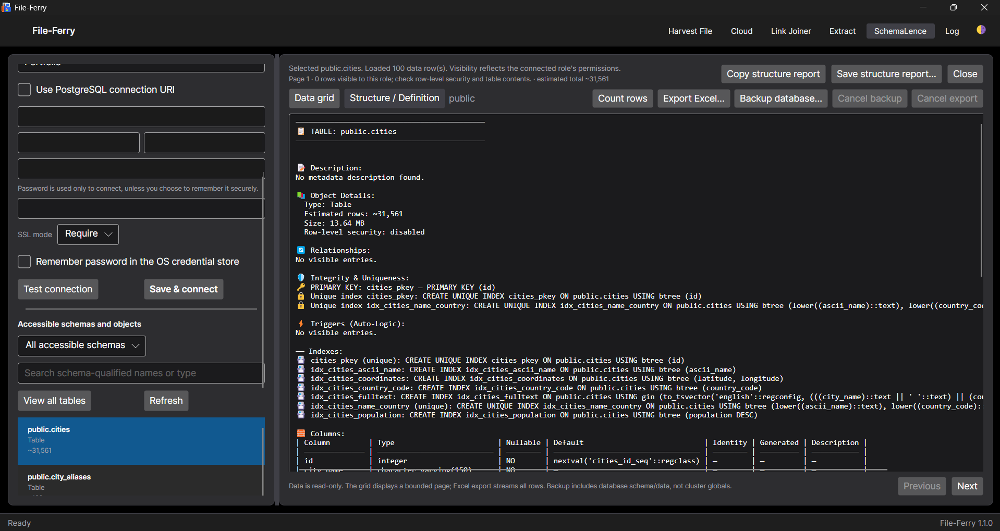
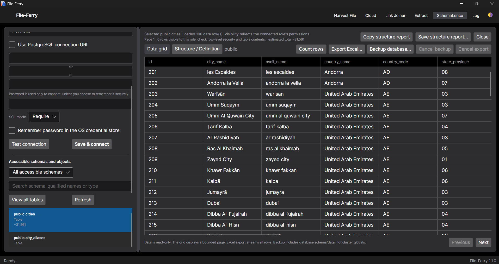
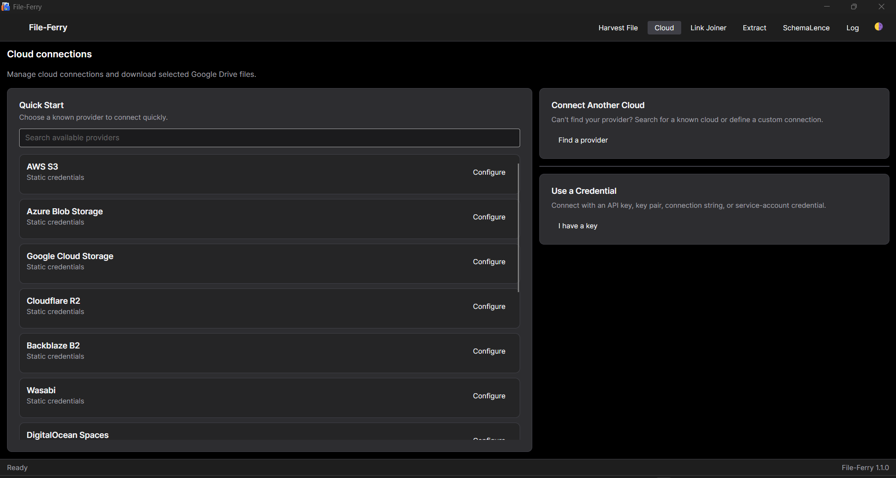

# File-Ferry

> Harvest files from anywhere on your PC. Copy them byte-for-byte. Deliver them in any format you choose.

File-Ferry is a Windows desktop toolkit for working with local files, cloud storage, text, paths, images, audio, video, documents, and PostgreSQL data. Its original file-harvesting workflow is joined by Cloud, SchemaLence, ImageTextify, Prompt, Code Viewer, Deployment Vault, Link Joiner, and Extract workspaces.

Built on **.NET 10**, **Avalonia UI 12**, and **Portfolio.Resilience 0.8.0**.

---

## Workspaces and Features

### Harvest — find, collect, and deliver files

- Add files by pasting paths or names, using the file picker, or choosing a
  folder.
- Resolve bare filenames across the PC; when a name has multiple matches,
  select the files you want with **Newest 5**, **Largest 5**, **Select All**,
  or **Select None** presets.
- Write to nine formats: `.txt`, `.md`, `.json`, `.html`, `.docx`, `.pdf`,
  `.xlsx`, `.csv`, and `.zip`.
- Choose **Separate Files** or **Single Merged** output, customize names, and
  opt into headers, manifests, and other formatting where available.
- Review and confirm before replacing an existing output file.

### Cloud — connect storage and work with remote files

- Configure built-in profiles for AWS S3, Cloudflare R2, Backblaze B2,
  Wasabi, DigitalOcean Spaces, MinIO, Azure Blob Storage, Google Cloud
  Storage, Google Drive, Microsoft OneDrive, and Dropbox.
- Use provider-specific credentials or OAuth setup. Credentials are kept in
  the operating system credential store where supported; the app does not
  save cloud secrets in plain-text profile files.
- Select and download Google Drive files from the Cloud workspace. Google
  Docs, Sheets, and Slides are exported as PDF, XLSX, and PPTX respectively.
- **Testing status:** Google Drive is the only cloud provider whose download
  flow has been tested end-to-end, including single- and multi-file downloads.
  The other providers are not yet verified for the same download workflow;
  testing and completing those flows is planned for a future release.
- See the [user guide](docs/user-guide.md) for setup, permissions, and current
  provider workflow details. Cloud provider capabilities and account setup
  requirements differ.

### SchemaLence — inspect PostgreSQL safely

- Connect to PostgreSQL and browse accessible schemas, tables, and views.
- Inspect table definitions, constraints, indexes, triggers, and supported
  pgvector metadata.
- Preview role-visible rows in a read-only data grid and export table or view
  rows to Excel (`.xlsx`).
- Create a PostgreSQL custom-format backup (`.dump`) with `pg_dump`. Restore
  it with PostgreSQL's `pg_restore`; cluster roles and global settings are
  not included.
- The workspace does not provide arbitrary SQL execution or database
  editing. Backup requires PostgreSQL client tools, including `pg_dump`, on
  the app machine.

### Link Joiner — combine bases and paths

- Join one or more base folders to lists of relative paths in independent
  sections.
- Validate unsafe or ambiguous relative paths, optionally normalize
  separators or remove duplicates, then copy, save, or send results to
  Harvest.

### Extract — find useful text locally

- Extract links, file paths, email addresses, and phone-like strings from
  pasted text.
- Filter, copy, or save matches. Extraction runs locally and does not verify,
  open, or transmit the matched values.

### ImageTextify — turn images, PDFs, audio, and video into text

- Local OCR pipeline for images and scanned PDFs: PP-OCR detection and
  recognition, TrOCR for handwriting, and a Qwen vision fallback for
  difficult printed text.
- Audio and video transcription through Whisper, plus a live
  transcription workspace that streams microphone and system-audio
  loopback into a running transcript. Live transcription and audio
  capture are Windows-only; macOS and Linux are deferred.
- Opt-in WAV recording of captured audio.
- Camera capture workspace: enumerate a camera, preview, freeze a frame,
  and run it through the same OCR pipeline. Windows and Linux only;
  macOS is not supported by the camera library.
- Document and image conversion workspace: image format conversion,
  Markdown to DOCX/PDF, Word to Markdown, JSON to CSV, CSV to JSON, and
  any file to XLSX. Currently registered on Windows only.
- Text-to-speech workspace: Edge neural voices with a System.Speech
  fallback. Windows-only.
- Projects: `ImageTextify.Core` (contracts and domain models) and
  `ImageTextify.Platform` (OCR, PDF, media, audio, camera, conversion,
  and speech engines). The workspace UI lives in `FileHarvester.App`.

### Prompt — local prompt and document manager

- Category and subcategory tree, prompt editor with auto-save drafts,
  version history with restore, favorites, tags, and full-text search.
- Trash with restore, bulk export/move/tag/delete, and keyboard
  shortcuts.
- Import `.txt`, `.md`, `.docx`, and `.pdf`; export a single file or a
  zip tree through the shared format writers.
- Projects: `Prompt.Core` and `Prompt.Platform` (SQLite stores, FTS5
  search, importer/exporter). The workspace UI lives in
  `FileHarvester.App`.

### Code Viewer — inspect local projects

- Browse a project's file tree, open files in a syntax-highlighted code
  surface, and copy a file or the whole tree.
- Configurable exclusion rules for generated, dependency, and binary
  content.
- Projects: `CodeViewer.Core` (tree model, exclusions, role
  classification) and `CodeViewer.Platform` (project scanning). The
  workspace UI lives in `FileHarvester.App`.

### Deployment Vault — registry, EnvSafe, and KeyForge

- **Deployment Vault:** a local registry of deployed applications and
  their infrastructure records, with search, soft-delete and restore,
  permanent delete behind confirmation, and record export.
- **EnvSafe** (sub-app): convert `.env` content into a safe
  `.env.example` template with a safety scan, importing `.env`, `.txt`,
  `.md`, or `.docx` files or pasting directly.
- **KeyForge** (sub-app): detect key-shaped strings (prefixed tokens,
  JWTs, Base64 blobs, UUIDs, PEM blocks, and a generic fallback) in
  pasted text or imported documents (`.txt`, `.md`, `.env`, `.json`,
  `.yaml`, `.docx`, `.pdf`, `.xlsx`), and forge shape-identical fake
  keys — deterministic by default, random on Regenerate — with a
  detected-keys panel, per-key copy, and save-to-disk.
- Projects: `DeploymentVault.Core` and `DeploymentVault.Platform`
  (SQLite store, EnvSafe converters, KeyForge extraction/forgery, and
  document readers). The workspace UI lives in `FileHarvester.App`.

### App-wide tools

- Light/dark appearance, a responsive Avalonia interface, live operation
  logging, and resilience diagnostics.
- Cancellable long-running exports and backups, with temporary-file cleanup
  so partial outputs are not presented as completed files.

---

## Quickstart

### For Users — Download and Run on Windows

1. Download the latest Windows x64 ZIP from
   [GitHub Releases](https://github.com/sancy1/file-ferry/releases/latest).
2. Extract the ZIP, keeping `FileFerry.exe` and the `LatoFont` folder together.
3. Run `FileFerry.exe`; no installer or separately installed .NET runtime is
   required.
4. Choose a workspace from the top bar: **Harvest File**, **Cloud**,
   **ImageTextify**, **Link Joiner**, **Extract**, **Prompt**,
   **Code Viewer**, **Deployment Vault**, or **SchemaLence**. ImageTextify
   also opens the live transcription, camera capture, conversion, and
   text-to-speech sub-pages. Deployment Vault opens the EnvSafe and
   KeyForge sub-apps from its action rail.

> **The published download is a self-contained Windows x64 build.** Cloud
> services may require your own provider account, credentials, or OAuth app
> configuration. SchemaLence connects to a PostgreSQL server you provide; it
> does not include a database server.

### For Developers — Build from Source

```powershell
git clone https://github.com/sancy1/file-ferry.git
cd file-ferry
dotnet restore FileHarvester.slnx
dotnet build FileHarvester.slnx
dotnet run --project src\FileHarvester.App\FileHarvester.App.csproj
```

`ImageTextify.Core` and `ImageTextify.Platform` set
`GenerateDocumentationFile`, so their XML documentation files are emitted
to `bin/` on every build. The other projects do not currently generate
XML documentation.

### Publish a Windows x64 Executable

```powershell
dotnet publish src\FileHarvester.App -c Release -r win-x64 --self-contained `
    -p:PublishSingleFile=true `
    -p:IncludeNativeLibrariesForSelfExtract=true `
    -p:EnableCompressionInSingleFile=true `
    -o artifacts\FileFerry-v1.4.0-win-x64
```

Rename `FileHarvester.App.exe` to `FileFerry.exe` for the release package.
If the runtime package contains `LatoFont`, include it beside the executable.
The published app requires Windows x64; database backup additionally requires
the PostgreSQL client tool `pg_dump` to be installed and available on `PATH`.

The first public release was `v1.0.0`. `v1.1.0` added cloud connections
and Google Drive downloads, PostgreSQL inspection and export, Link
Joiner, Extract, and overwrite confirmation. `v1.2.0` added the Prompt
and Code Viewer workspaces and the ImageTextify extraction suite (OCR,
transcription, live capture, camera, conversion, and text-to-speech).
`v1.3.0` adds the Deployment Vault workspace with the EnvSafe and
KeyForge sub-apps. `v1.4.0` adds the KeyMaster sub-app to Deployment
Vault: framework-aware cryptographic key generation (JWT, Django,
FastAPI, Flask, ASP.NET Core, Go, Java) with guardrails, entropy
metering, and batch generation. Check
[GitHub Releases](https://github.com/sancy1/file-ferry/releases) for the
currently published version and its release notes.

---

## Technology Stack

| Layer                | Technology                                    |
| -------------------- | --------------------------------------------- |
| Runtime              | .NET 10                                       |
| Language             | C# 14                                         |
| UI                   | Avalonia UI 12.1.2                            |
| Resilience           | Portfolio.Resilience 0.8.0                    |
| Resilience Analyzers | Portfolio.Resilience.Analyzers 0.8.0          |
| Format Writers       | DocumentFormat.OpenXml · QuestPDF · ClosedXML |
| Dependency Injection | Microsoft.Extensions.DependencyInjection 10.0 |
| Testing              | xUnit · FluentAssertions                      |

---

## Architecture

```text
FileHarvester.App       (Avalonia UI — all workspaces and sub-pages)
FileHarvester.Core      (file workflows, cloud contracts, shared domain logic)
FileHarvester.Platform  (file-system and cloud-provider adapters)
SchemaLence.Core        (database contracts and metadata models)
SchemaLence.Platform    (PostgreSQL provider and local persistence)
ImageTextify.Core       (OCR, media, audio, camera, conversion, speech contracts)
ImageTextify.Platform   (ONNX OCR, Whisper, NAudio, Periphery.Camera, converters, TTS)
Prompt.Core             (prompt domain models and store contracts)
Prompt.Platform         (SQLite stores, FTS5 search, import/export)
CodeViewer.Core         (project tree model, exclusions, classification)
CodeViewer.Platform     (project scanning)
FileHarvester.Tests     (xUnit — app, core, and platform behavior)
```

### Data Flow

```text
User input
    ↓
FileRequest[]
    ↓
IFileResolver
    ↓
ResolvedFile[]
    ↓
IContentReader
    ↓
FileContent[]
    ↓
IBundleComposer
    ↓
ComposedDocument
    ↓
IFormatWriter
    ↓
bytes
    ↓
IOutputSink
    ↓
files on disk
```

Network and file operations use named **Portfolio.Resilience** policies for
retry, circuit breaking, timeout, and rate limiting where appropriate.
Operations such as database backups have their own cancellation-aware
lifecycle rather than the short timeout used for ordinary local writes.

### Resilience Policies

| Policy                 | Used for                                              |
| ---------------------- | ----------------------------------------------------- |
| `file-read`            | Local file checks and reads                          |
| `path-search`          | PC-wide filename search                              |
| `bundle-write`         | Ordinary local output writes                         |
| `cloud-read` / `write` | Remote object reads and writes                       |
| `cloud-search`         | Remote search and listing                            |
| `cloud-auth`           | OAuth and credential validation                      |
| `credential-store-write` | Secure credential persistence                      |

See [`docs/resilience-usage.md`](docs/resilience-usage.md) for the current
policy configuration.

---

## Repository Layout

```text
file-ferry/
├── .editorconfig
├── .gitignore
├── global.json
├── Directory.Build.props
├── Directory.Packages.props
├── FileHarvester.slnx
├── README.md
├── CHANGELOG.md
├── LICENSE
├── artifacts/                    Build output and release packages (git-ignored)
├── bench/                        ImageTextify OCR evaluation harness (not shipped)
├── docs/                         User, architecture, and verification guides
├── src/
│   ├── FileHarvester.App/        Avalonia UI and workspaces
│   ├── FileHarvester.Core/       File and cloud domain logic
│   ├── FileHarvester.Platform/   File and cloud adapters
│   ├── SchemaLence.Core/         Database contracts
│   ├── SchemaLence.Platform/     PostgreSQL and local store
│   ├── ImageTextify.Core/        Extraction and media contracts
│   ├── ImageTextify.Platform/    OCR, transcription, camera, conversion, TTS
│   ├── Prompt.Core/              Prompt domain contracts
│   ├── Prompt.Platform/          Prompt stores, search, import/export
│   ├── CodeViewer.Core/          Project tree and exclusion model
│   ├── CodeViewer.Platform/      Project scanning
│   ├── DeploymentVault.Core/     Vault, EnvSafe, and KeyForge contracts
│   ├── DeploymentVault.Platform/ Vault store, EnvSafe, KeyForge engines
│   └── FileHarvester.Tests/      xUnit test suite
└── FileHarvester.slnx            Solution
```

---

## Testing

Run the complete test suite with:

```powershell
dotnet test FileHarvester.slnx
```

Current coverage includes:

- Harvest and output behavior
- Cloud providers, credentials, and downloads
- SchemaLence PostgreSQL and Excel export
- Link Joiner and Extract
- ImageTextify OCR, transcription, camera, conversion, and speech
- Prompt stores, search, import/export, and documentation contracts
- CodeViewer tree, exclusions, and classification
- UI view models, documentation contracts, and resilience behavior

The tests are in [`src/FileHarvester.Tests/`](src/FileHarvester.Tests/).

---

## Release Notes

The `v1.1.0` release added cloud connections and Google Drive downloads,
PostgreSQL inspection and export, Link Joiner, Extract, overwrite
confirmation, and related reliability and UI improvements. `v1.2.0`
added the Prompt and Code Viewer workspaces and the ImageTextify
extraction suite (OCR, transcription, live capture, camera, conversion,
and text-to-speech). `v1.3.0` adds the Deployment Vault workspace with
the EnvSafe and KeyForge sub-apps and unifies the preview-window design
across the Convert, EnvSafe, and KeyForge workspaces. `v1.4.0` adds the
KeyMaster sub-app to Deployment Vault: framework-aware cryptographic
key generation with guardrails, entropy metering, and batch generation.
See
[`CHANGELOG.md`](CHANGELOG.md) and the
[release page](https://github.com/sancy1/file-ferry/releases) for the
versioned change history.

---

## License

MIT License — see [`LICENSE`](LICENSE).

---

## Author

**Alexander Sanchez Cyril**


---

## Screenshot

<p align="center">
  
</p>

<p align="center">
  
</p>

<p align="center">
  
</p>
